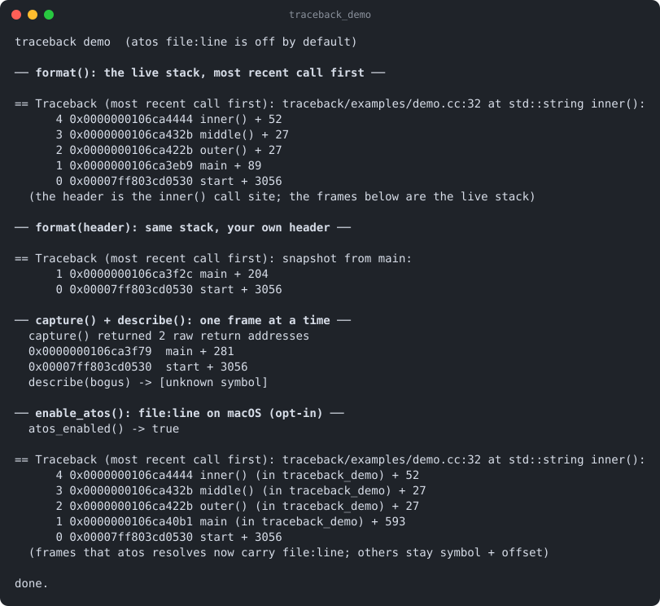

# traceback

[](https://github.com/Kronuz/traceback/actions/workflows/ci.yml)
[](LICENSE)


Readable stack traces for C++20: capture the current call stack and render it
with demangled symbols, and `file:line` on macOS. Opt in to a whole-process
crash dumper that prints every registered thread's stack at once. For error
reports, crash handlers, and debugging hangs.



## ✨ Highlights

- **One call.** `traceback::format()` returns the current stack, most recent call
  first, with demangled `symbol + offset`.
- **Safe on error paths.** `format` and `describe` never throw; unresolvable
  frames read `[unknown symbol]`.
- **Source locations on macOS** through a persistent `atos` helper, off by
  default.
- **Opt-in crash dumper** (`TRACEBACK_HOOKS`): a lock-free thread registry and a
  SIGUSR2 walker that dump all threads, telling idle from active.
- **Opt-in throw-site stacks** (`TRACEBACK_THROW_HOOKS`, Linux and FreeBSD):
  recover where an exception was thrown.
- **Ready for `std::stacktrace`**: the API can switch to C++23's implementation
  without changing callers.

## 📦 Installation

Requires a C++20 compiler and CMake 3.16 or newer; it fetches
[strings](https://github.com/Kronuz/strings),
[errno-names](https://github.com/Kronuz/errno-names),
[term-color](https://github.com/Kronuz/term-color), and
[nanosleep](https://github.com/Kronuz/nanosleep). Build with
`-fno-omit-frame-pointer` for reliable frames in optimized code. CI builds it on
Linux (x86_64, arm64), macOS (arm64, x86_64), and FreeBSD, plus ASan, UBSan, and
TSan builds.

```cmake
include(FetchContent)
FetchContent_Declare(traceback
  GIT_REPOSITORY https://github.com/Kronuz/traceback.git
  GIT_TAG        main)
FetchContent_MakeAvailable(traceback)

target_link_libraries(my_app PRIVATE traceback::traceback)
```

## 🚀 Quick start

```cpp
#include "traceback.h"

#include <cstdio>
#include <source_location>

int main() {
	std::string tb = traceback::format(std::source_location::current());
	std::fputs(tb.c_str(), stderr);
}
```

```text
== Traceback (most recent call first): demo.cc:7 at int main():
    1 0x0000000104298... main + 36
    0 0x000000018861f... start + 6992
```

[`examples/demo.cc`](examples/demo.cc) walks nested calls, the raw `capture` and
`describe` layer, and the `atos` opt-in.

## 🎯 When to use it

- ✅ Attaching a stack to error reports and assertion failures.
- ✅ Finding where every thread is stuck in a hung server (`TRACEBACK_HOOKS`).
- ❌ Throw-site tracking on macOS, or alongside tcmalloc, jemalloc, or sanitizers:
  `TRACEBACK_THROW_HOOKS` interposes `malloc` and `free`, which needs global symbol
  interposition and conflicts with other allocators. CMake refuses it on Apple.

## 📚 Documentation

- [docs/API.md](docs/API.md): the formatting API, the raw layer, the crash
  dumper and its host glue, the two opt-ins, `atos`, and `std::stacktrace`.
- [ARCHITECTURE.md](ARCHITECTURE.md): capture, symbolization, the registry, and
  the signal-handler walk.
- [AGENTS.md](AGENTS.md): repository map, build options, and traps.

## 🛠️ Building and testing

```sh
cmake -B build && cmake --build build && ctest --test-dir build
./build/traceback_demo
cmake -B build-hooks -DTRACEBACK_HOOKS=ON && cmake --build build-hooks   # the dumper
```

## 🤝 Contributing

Issues and pull requests are welcome. Read [AGENTS.md](AGENTS.md) first. CI must
pass on every platform.

## 📄 License

MIT. Extracted from [Xapiand](https://github.com/Kronuz/Xapiand), Copyright (c)
2015-2019 Dubalu LLC; modernized by Germán Méndez Bravo. See [LICENSE](LICENSE).
